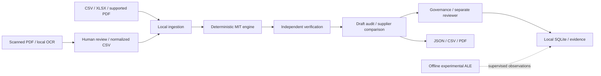

# Ledger64

**Learn from every invoice. Make every decision count.**

A local-first, open-source purchasing intelligence and invoice auditing tool for small and medium-sized businesses. A C64-inspired interface meets deterministic financial calculations, traceable evidence and human oversight.

[](LICENSE) [](https://www.python.org/) [](#documentation) [](https://github.com/OscarMorelli78/Ledger64/actions/workflows/container.yml) [](https://github.com/OscarMorelli78/Ledger64/actions/workflows/international.yml)

**[Try the browser demo](https://oscarmorelli78.github.io/Ledger64/demo/) · [Latest release](https://github.com/OscarMorelli78/Ledger64/releases/latest) · [Project website](https://oscarmorelli78.github.io/Ledger64/) · [Report an issue](https://github.com/OscarMorelli78/Ledger64/issues)**

> Synthetic data only until deployment-specific security, privacy and real-document validation pass. No accounting or tax certification; EUR purchases excluding VAT; no credit notes or payment execution.

## See Ledger64 in action

Real C64 interface captures are produced by the authenticated Chromium acceptance test using a fictitious tenant and the included synthetic invoices. The v0.1.1 release workflow publishes the screenshots only after its acceptance gates pass.


[Spanish screenshot](https://github.com/OscarMorelli78/Ledger64/releases/download/v0.1.1/ledger64-c64-es.png) · [Browser acceptance workflow](https://github.com/OscarMorelli78/Ledger64/actions/workflows/international.yml)

## What it does for SMEs

| Use case | Business value |
|---|---|
| Retail and wholesalers | Flag possible duplicate invoice lines and arithmetic discrepancies before payment review. |
| Hospitality | Compare identical ingredients or supplies in common units across suppliers; estimate potential savings. |
| Manufacturing and services | Detect unit-price increases of at least 10% and investigate purchasing conditions. |
| Finance and purchasing teams | Record evidence, approved product aliases, review decisions and draft reports with separation of duties. |

Estimated savings and flagged amounts are not confirmed paid losses or guarantees. Validate quality, delivery, minimum orders and commercial terms before changing suppliers.

## Quick start — local Docker

Prerequisite: Docker Engine or Docker Desktop with Compose v2. Clone or extract the source into a private directory and run from its root:

```bash
docker compose -f compose.local.yaml up --build -d
```

This starts the authenticated service at **http://127.0.0.1:8765/login** with a persistent named volume, no public proxy, and no default accounts. Create your own company and users (the CLI prompts for passwords of at least 14 characters):

```bash
docker compose -f compose.local.yaml exec app python admin.py company Demo
# Replace COMPANY_ID with the returned ID.
docker compose -f compose.local.yaml exec app python admin.py user COMPANY_ID demo-owner --role owner
docker compose -f compose.local.yaml exec app python admin.py user COMPANY_ID demo-analyst --role analyst
```

Sign in, select your language and click **Load demo**. Stop without deleting the data volume:

```bash
docker compose -f compose.local.yaml down
```

Local HTTP is for a trusted workstation only. Do not bind to a public interface. For native Python 3.13 installation (Windows, macOS, Linux), [read the installation manual](docs/manual/en.md#1-installation). For HTTPS container deployment, see [RELEASE.md](RELEASE.md); real data remains out of scope.

## Architecture at a glance



The stable engine uses decimal arithmetic and explicit rules. No external AI API or autonomous payment. The independent verification, approvals and local audit trail are distinct from accounting certification.

## Features and boundaries

- Structured CSV UTF-8, single-sheet XLSX without macros or formulas, supported digital PDF; scanned PDF OCR is a draft for review (English/Spanish models).
- Up to 2 MB per document, 10,000 rows, 2–20 batch files / 8 MB total; positive quantities, common EUR net units, no general-purpose invoice extraction guarantee.
- Arithmetic checks, duplicate detection, recent supplier comparisons and estimated savings; comparisons exclude invalid or conflicting lines and use recent observations within 30 days.
- Authenticated company isolation, roles, evidence, approval workflows, local reports and PDF export.
- ALE remains a separate supervised offline experimental learner; it does not automatically learn from production uploads or modify financial rules.

## Experimental Procurement Intelligence — separate branch

The opt-in pilot adds cumulative order/receipt/invoice matching, partial deliveries, multiple invoices, configurable tolerances, contract discounts, reviewed OCR, supplier layout memory, revisions and verified SQLite recovery. **108/108 tests passed at f9fd4a66**; five-image acceptance was 4/5 first-pass and 5/5 after simulated review. This is not part of the stable runtime or approved for production.

[Try the nine-language matching simulation](https://oscarmorelli78.github.io/Ledger64/demo/procurement.html) — static illustration, not the Python engine. [Experimental source](https://github.com/OscarMorelli78/Ledger64/tree/feat/adaptive-procurement-v1) · [Draft PR #2](https://github.com/OscarMorelli78/Ledger64/pull/2) · [CI evidence](https://github.com/OscarMorelli78/Ledger64/actions/runs/45889543410).

## Documentation

Nine interface and manual languages. OCR recognition models are English/Spanish, not nine-language OCR. Technical identifiers and source evidence remain unchanged.

| Language | Stable manual | Experimental manual |
|---|---|---|
| English | [README](README.en.md) · [Manual](docs/manual/en.md) | [Pilot](https://github.com/OscarMorelli78/Ledger64/blob/feat/adaptive-procurement-v1/docs/manual/en.md) |
| Español | [README](README.es.md) · [Manual](docs/manual/es.md) | [Pilot](https://github.com/OscarMorelli78/Ledger64/blob/feat/adaptive-procurement-v1/docs/manual/es.md) |
| Français | [README](README.fr.md) · [Manual](docs/manual/fr.md) | [Pilot](https://github.com/OscarMorelli78/Ledger64/blob/feat/adaptive-procurement-v1/docs/manual/fr.md) |
| Italiano | [README](README.it.md) · [Manual](docs/manual/it.md) | [Pilot](https://github.com/OscarMorelli78/Ledger64/blob/feat/adaptive-procurement-v1/docs/manual/it.md) |
| Deutsch | [README](README.de.md) · [Manual](docs/manual/de.md) | [Pilot](https://github.com/OscarMorelli78/Ledger64/blob/feat/adaptive-procurement-v1/docs/manual/de.md) |
| Português (Brasil) | [README](README.pt-BR.md) · [Manual](docs/manual/pt-BR.md) | [Pilot](https://github.com/OscarMorelli78/Ledger64/blob/feat/adaptive-procurement-v1/docs/manual/pt-BR.md) |
| 简体中文 | [README](README.zh-CN.md) · [Manual](docs/manual/zh-CN.md) | [Pilot](https://github.com/OscarMorelli78/Ledger64/blob/feat/adaptive-procurement-v1/docs/manual/zh-CN.md) |
| 日本語 | [README](README.ja.md) · [Manual](docs/manual/ja.md) | [Pilot](https://github.com/OscarMorelli78/Ledger64/blob/feat/adaptive-procurement-v1/docs/manual/ja.md) |
| हिन्दी | [README](README.hi.md) · [Manual](docs/manual/hi.md) | [Pilot](https://github.com/OscarMorelli78/Ledger64/blob/feat/adaptive-procurement-v1/docs/manual/hi.md) |

[Architecture](docs/ARCHITECTURE.md) · [Security](SECURITY.md) · [Deployment](RELEASE.md) · [Roadmap](ROADMAP.md) · [Changelog](CHANGELOG.md)

## Privacy and contribution

Keep business data, credentials, backups and private model parameters out of GitHub. Back up authentication and company databases separately; restore into a new scope. Local hash chains have no external integrity anchor. CI is not a production security certification. Original code is MIT; dependencies retain their respective licenses.

[Contributing](CONTRIBUTING.md) · [Support](SUPPORT.md) · [Commercial services](COMMERCIAL.md) · [Contact](CONTACT.md) · [Developer portfolio](https://github.com/OscarMorelli78?tab=repositories)

